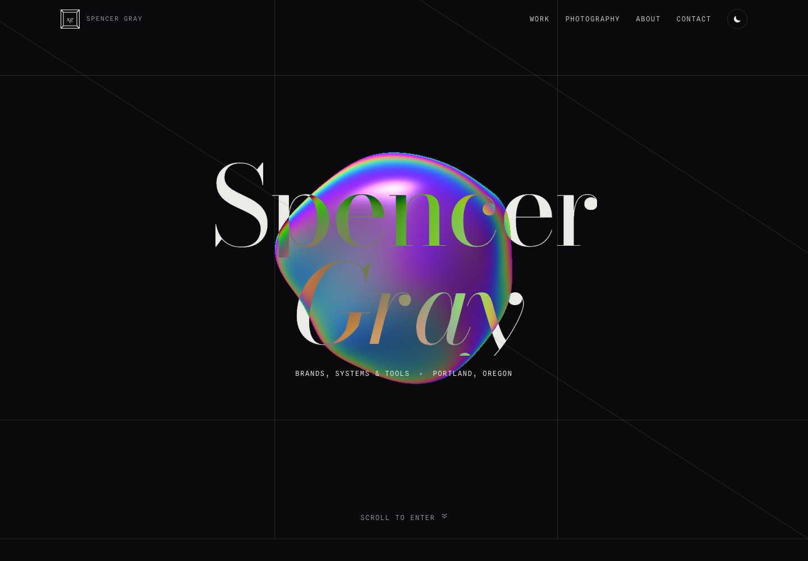
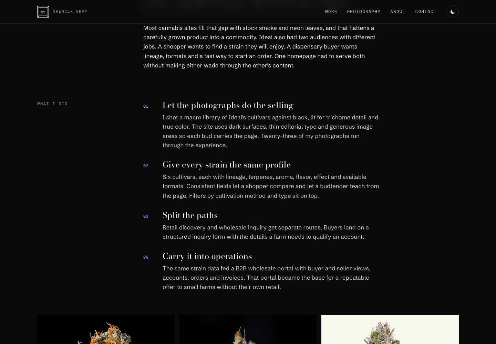
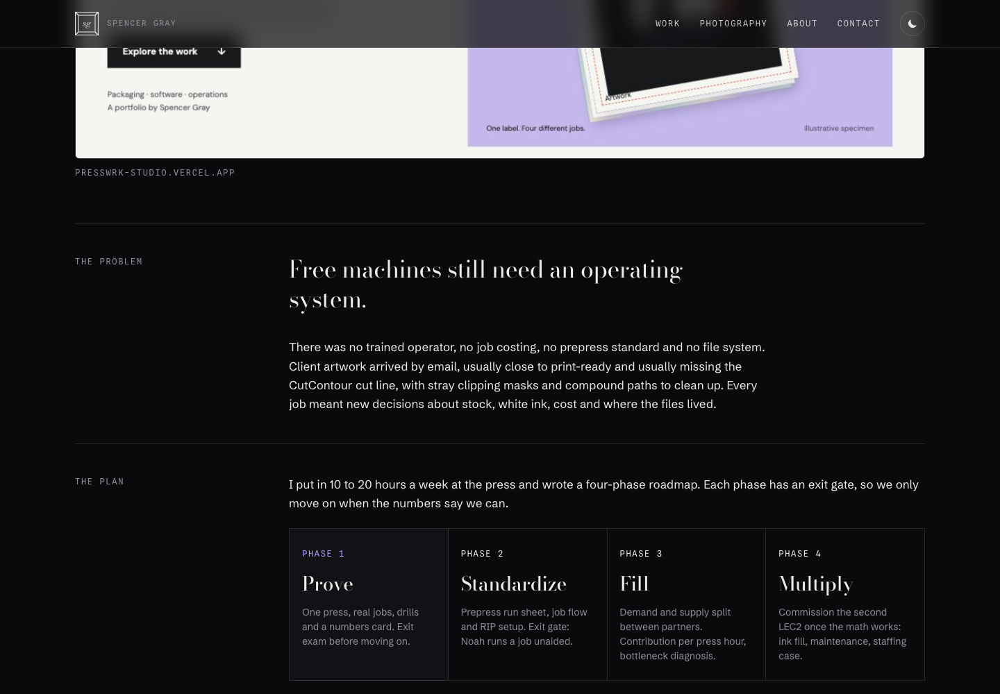
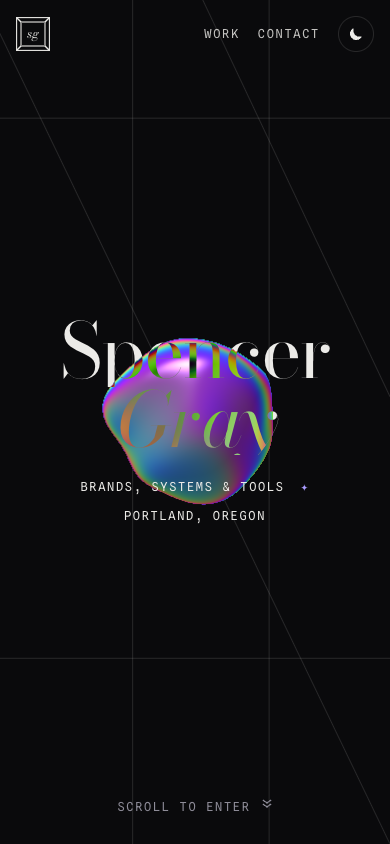

# Spencer Gray — Brand, Operations & Software

**[🚀 Live Demo](https://spencerdotgray.vercel.app/)**

Spencer Gray’s personal portfolio connects creative direction with practical business systems. Explore six project stories showing how he approaches branding, web experiences, print production, workflow design, AI-assisted products, retail data, and photography.

## What you’ll find

| Section | Work presented | Skills and strengths showcased |
| --- | --- | --- |
| Ideal Cannabis | Brand, product photography, website and wholesale experience | Visual storytelling, brand consistency, e-commerce thinking, creative execution |
| PRESSWRK label press | Print operations, production decisions and browser tools | Process design, prepress knowledge, constraint-driven problem solving |
| Systems teams adopted | Operational workflow stories across roles | Diagnosing friction, simplifying handoffs, building tools people can use |
| Operator Intelligence | AI product case study with a link to the project | Product thinking, translating operational needs into software, AI-assisted development |
| Flower Spectrum | Retail data tools, menu generation and COA visualization | Data organization, information design, domain knowledge and decision support |
| Live & macro | Concert and cannabis macro photography | Composition, timing, lighting and visual craft |

The through-line is taking an ambiguous business problem from research and planning through design and a working implementation. About and contact sections provide background, an email-copy control and LinkedIn access.

This repository contains the portfolio presentation. Linked products are separate projects; their backends and production systems are not included here. Project and career narratives are retained from the supplied portfolio rather than independently audited by this release.

## Screenshots

Real browser captures of the site, with dark theme enabled.





## Run locally

No installation, build step, environment variables or API keys are required.

```sh
python3 -m http.server 4173
```

Open http://localhost:4173. The site uses HTML, CSS, vanilla JavaScript and a WebGL hero. Google Fonts is the only external presentation dependency; system-font fallbacks are included.

## Sharing

Share **https://spencerdotgray.vercel.app/**. Open Graph and Twitter Card metadata include a description and a 1200 × 630 PNG preview at `documentation/assets/social-preview.png`. Social platforms may cache previews or crop them differently.

Suggested description: “Spencer Gray’s portfolio: brand and web design, print operations, workflow systems, AI products, retail data tools, and photography.”

## Architecture and provenance

- `index.html`: responsive single-page portfolio, styles and interactions.
- `img/`: original project and photography assets.
- `documentation/assets/`: desktop, mobile, case-study and social-preview captures.
- `source/`: verbatim original HTML and source ZIP checksum.
- `vercel.json`: static hosting configuration.

The supplied ZIP is preserved outside this checkout. Its original HTML is retained in `source/`; deployment changes add metadata and a favicon without rewriting project narratives. Photography and portfolio content remain their owners’ work; this repository does not grant reuse rights.

## Recent updates

- Packaged the supplied portfolio for GitHub and Vercel.
- Added desktop/mobile previews, project documentation, favicon, sitemap and social sharing metadata.
- See [CHANGELOG.md](CHANGELOG.md) and [TESTING.md](TESTING.md).
